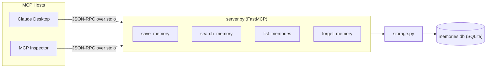
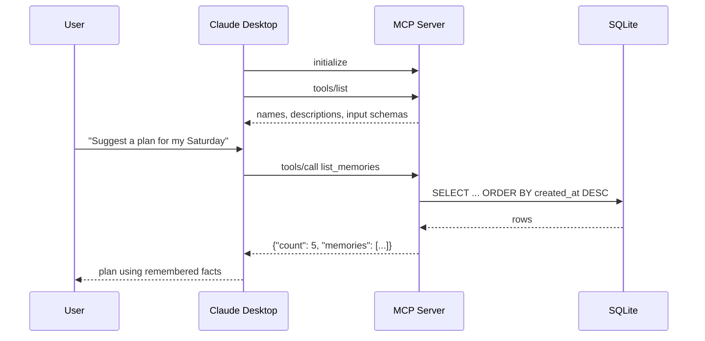

# MCP Memory Server

Long-term memory for AI agents, exposed over the Model Context Protocol (MCP).

LLM agents are stateless: every new session starts from zero, because the context window disappears when the conversation ends. This server gives any MCP client (Claude Desktop, a LangGraph agent, the MCP Inspector) a persistent memory it can save to, search, list, and forget from. Memories survive across conversations, server restarts, and clients.


## Architecture



### How a tool call flows



## Tools

| Tool | What it does | Hint |
|---|---|---|
| `save_memory(content, tags="")` | Stores a fact, returns its id | |
| `search_memory(query, limit=5)` | Keyword search over content and tags, newest first | read-only |
| `list_memories(limit=20)` | Most recent memories, newest first | read-only |
| `forget_memory(memory_id)` | Deletes a memory, reports whether it existed | destructive |

## Design decisions

- **Two layers.** `server.py` owns the MCP surface (tools, schemas, validation). `storage.py` owns the data. Swapping SQLite for a vector store only touches `storage.py`.
- **Docstrings are prompts.** The model never sees the Python code, only each tool's name, description, and JSON schema. Descriptions tell the model when to call a tool and how to fill each argument.
- **Validation at the boundary.** Pydantic `Field` constraints (`min_length`, `ge`, `le`) become part of the schema and are enforced before any SQL runs. Invalid calls return a readable tool error the model can recover from.
- **Bounded results.** `limit` caps every read, because everything a tool returns lands in the model's context window.
- **Honest results.** `forget_memory` reports "not found" instead of pretending success, and reads return a `count` so an empty result is explicit.
- **Tool annotations.** Read tools are marked `readOnlyHint`, delete is marked `destructiveHint`, so clients can auto-approve reads and confirm deletes.
- **Safe SQL.** All queries are parameterized. Inputs come from an LLM, so injection safety matters more, not less.
- **stdio transport.** The host launches the server as a subprocess. stdout carries protocol messages only; logs go to stderr.

## Quickstart

Requires Python 3.10+ and [uv](https://docs.astral.sh/uv/).

```bash
git clone https://github.com/Sakshi3027/mcp-memory-server.git
cd mcp-memory-server
uv sync
uv run mcp dev server.py   # opens the MCP Inspector
```

### Connect to Claude Desktop

Add this to `~/Library/Application Support/Claude/claude_desktop_config.json`, using absolute paths, then fully restart Claude Desktop:

```json
{
  "mcpServers": {
    "memory": {
      "command": "/absolute/path/to/uv",
      "args": ["--directory", "/absolute/path/to/mcp-memory-server", "run", "server.py"]
    }
  }
}
```

Set `MEMORY_DB_PATH` to store the database somewhere other than the project folder.

## Tests

```bash
uv run pytest -v
```

Each test runs against its own temporary database. The suite covers storage behavior (ordering, search, limits, deletes) and the MCP layer (tool registration and schema validation).

## Roadmap

1. **SQLite FTS5** full-text search with BM25 ranking for better keyword relevance.
2. **Embeddings + vector store** for semantic recall, so "plant-based" finds "vegetarian".
3. **Memory scoping** per user or project, plus deduplication of near-identical memories.
4. **Preferences as an MCP resource**, so stable facts load into context up front instead of depending on the model to search for them.
5. **Streamable HTTP transport** so one server can serve multiple remote clients.